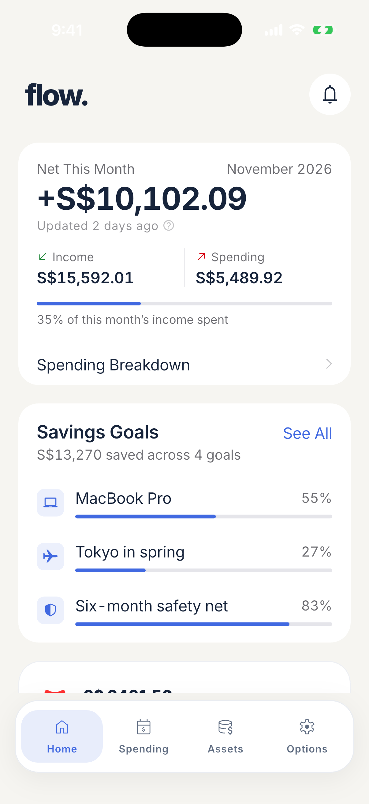
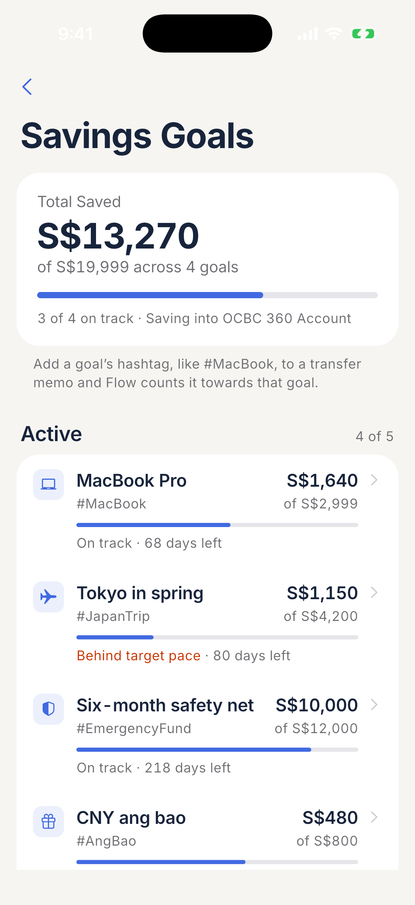
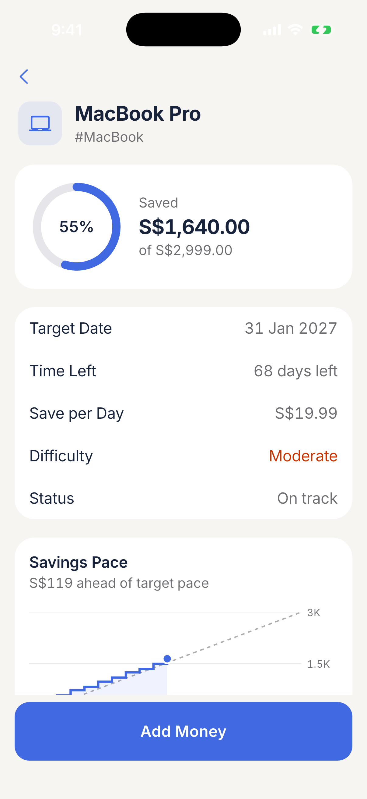
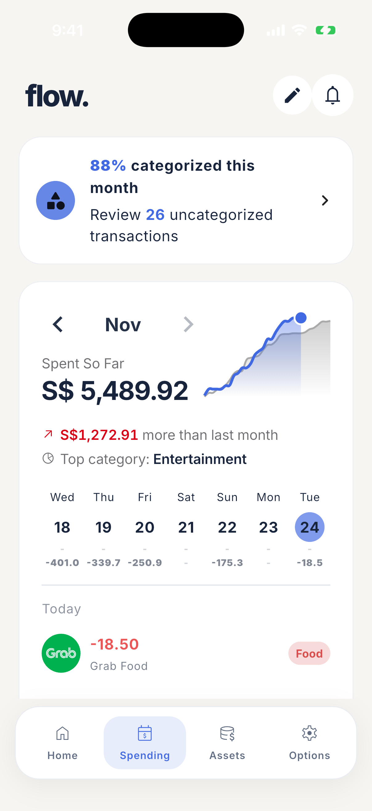

# Flow Financials — Flow

> A personal finance app that brings spending across all of a user's Singapore bank accounts into one place, for young working adults in Singapore.

## 1. Snapshot

| Field | Answer |
|---|---|
| Status | Active — last updated 26 Nov 2026 |
| Idea conceived · team formed · joined SEP | Aug 2025 · Aug 2025 · Sep 2025 (accepted as GreenerSupply; see Team changes) |
| Stage | Prototype |
| Company incorporated? | No |
| Mentor / supervisor | None |
| Our 3 metrics | 1. Google Play downloads (cumulative) 2. Supported banks 3. App store availability |
| Latest numbers | 1. 50+ 2. 3 (DBS, OCBC, UOB) 3. Google Play live; App Store pending (as of Nov 2026) |
| Latest video | [Update 5 – Nov 2026](https://youtube.com/shorts/4Q9iQZ0wlI4) |
| Website / demo | https://flowfinancials.io |

## 2. Team

| Name | Role | Programme & expected graduation | Hours per week on venture | Joined | GitHub |
|---|---|---|---|---|---|
| Jae Hyeok Kim | Co-founder, software developer | NUS Computer Science, Dec 2026 | ~8 | Aug 2025 | [@zzawook](https://github.com/zzawook) |
| Dobin Kim | Co-founder, software developer | NTU Computer Science, May 2027 | ~8 | Aug 2025 | [@kimdobinn](https://github.com/kimdobinn) |

**Team changes:** Our team was accepted into SEP in September 2025 under the name GreenerSupply (Greener Supply Chain), led by Park Jihae, with an AI tool for supply-chain carbon accounting. The team pivoted to Flow, a personal finance app, in August 2025, and Park Jihae has since left the team. Jae Hyeok Kim and Dobin Kim continue Flow.

## 3. Problem, solution and SEP milestones

**Problem and customer:** Young working adults in Singapore typically hold accounts and cards across several banks (DBS, OCBC, UOB). Each bank app shows only its own slice, so people cannot see in one place where their money goes each month, and saving towards a goal is hard to track.

**Solution:** Flow connects to Singapore banks (DBS, OCBC, UOB) without storing credentials, categorises transactions automatically, and shows spending, assets and trends across all accounts in one app. Savings Goals lets users save towards a target by tagging transfers with a goal hashtag (e.g. #MacBook) and shows whether they are on pace. Compared with checking each bank app separately (or doing nothing), users get one view of all their money.

**SEP milestones:**

| # | Milestone | Target date | Status | Evidence |
|---|---|---|---|---|
| 1 | Working app with bank connections for DBS, OCBC and UOB | Mar 2026 | Done | [Mar 2026 update](https://youtube.com/shorts/rhBuQKrDwZo) |
| 2 | Release on Google Play | Apr 2026 | Done — production access granted Apr 2026 | Update 2 below |
| 3 | Release on the App Store | 2027 | Paused — focusing on Android while legal requirements for handling financial data on iOS are sorted out | Update 2 below |
| 4 | Redesigned, iOS-native interface | Nov 2026 | Done on development branch (not yet released) | Update 4, Update 5 |
| 5 | Savings Goals connected to live account data | Jan 2027 | On track — UI prototype done (sample data) | Update 5 |

## 4. Updates (newest first)

### Update 5 — Nov 2026
**Video:** [Flow Financials – SEP Update 5 – Nov 2026](https://youtube.com/shorts/4Q9iQZ0wlI4) (2:29)

| Metric | Last update | Now |
|---|---|---|
| Google Play downloads (cumulative) | 50+ | 50+ |
| Supported banks | 3 (DBS, OCBC, UOB) | 3 (DBS, OCBC, UOB) |
| App store availability | Google Play live; App Store pending | Google Play live; App Store pending |
| Customer / user conversations this period | — | 0 |

- **Goals we set last time → result:** Narrated video update: done. Continue the UI revamp: done (iOS-native redesign of Home, Assets and Spending). Start goal-based savings: partly — UI prototype built with sample data, not yet connected to live accounts.
- **Highlights:** Savings Goals prototype (goals list, goal detail with progress ring and pace chart, three-step new-goal flow with difficulty preview); redesign of the Home balance card, Assets net worth card and Spending overview, which also fixed overlapping insight text. 8,096 automated tests pass (2 failures pre-date this work).
- **What went wrong or didn't work:** The Savings Goals screens run on sample data only; the work is on a development branch and not yet released. Our source repository is private, which made our earlier reports hard for reviewers to open — fixed with this public page.
- **Changes or pivots:** None this period. Time on the venture is lower (~8 hours/week each) because of final exams and job applications.
- **Who did what:** Jae Hyeok Kim and Dobin Kim built these features together; Dobin Kim prepared the reporting.
- **What we need from SEP:** Prior approval for AI development tools (Claude Max, about S$150/month) for Dec 2026–Jan 2027.
- **Goals for the next 2 months:** 1. Connect Savings Goals to live account data. 2. User-test the redesigned screens. 3. Release the redesign to the App Store and Google Play.

Screenshots (sample data):

| Home | Savings Goals | Goal detail | Spending |
|---|---|---|---|
|  |  |  |  |

### Update 4 — Sep 2026
**Video:** [Flow Financials – SEP Update 4 – Sep 2026](https://youtu.be/u8jfiVn5sZ8)

- **Goals we set last time → result:** Keep infrastructure costs low and stable: done. UI/UX revamp: partly — visual refresh completed on a development branch.
- **Highlights:** Refreshed palette (ivory/navy/cobalt), light and dark themes, new welcome screen, floating navigation, dashboard and asset layouts, consistent cards and inputs (34 files changed). 321 selected tests passing; reviewed in the iPhone simulator.
- **What went wrong or didn't work:** We missed the July 2026 update; the video had captions but no narration; our report was spread across several pages.
- **Changes or pivots:** None
- **What we need from SEP:** Prior approval for ChatGPT Pro (Codex) for Oct–Nov 2026.
- **Goals for the next 2 months:** 1. Narrated video updates. 2. Continue the UI revamp. 3. Start goal-based savings.

### July 2026 — no update submitted
We did not submit an update for July 2026. Work in July–August focused on the UI/UX revamp reported in Update 4.

### Update 3 — May 2026
**Video:** [Flow Financials – SEP Update 3 – May 2026](https://www.youtube.com/shorts/csP1gopzk9E)

- **Highlights:** Optimised the server setup and moved backend hosting to Hetzner, reducing monthly costs; completed most AI optimisation testing for the development cycle.
- **What went wrong or didn't work:** We deleted our Google Workspace account to save costs before downloading its final invoice, which also cut access to our AWS billing portal.
- **Changes or pivots:** Moved hosting from AWS/Vultr to Hetzner; reduced the AI subscription tier.
- **Goals for the next 2 months:** Maintain the reduced-cost setup; continue AI-assisted development.

### Update 2 — Mar 2026
**Video:** [Feature 4 UI update](https://youtube.com/shorts/rhBuQKrDwZo) · earlier page: [FLOW_progress_update](https://github.com/pimangnono/FLOW_progress_update)

- **Highlights:** Launched the website (flowfinancials.io); Google Play beta testing, then production access in April 2026; App Store submission in review.
- **Changes or pivots:** None

### Update 1 — Jan 2026
**Videos:** [Video 1](https://youtu.be/54Fta0YFRtg) · [Video 2](https://youtu.be/1xcWpcUH5mw) · [Pitch deck (Canva)](https://www.canva.com/design/DAG6c_vyjVs/C1D3LJOKq6Y9FhcVfyelpA/edit) · [Design (Figma)](https://www.figma.com/design/kRfU0DJUNufzFTuijayfUU/Flow-Mobile)

- **Changes or pivots:** Pivoted from GreenerSupply (supply-chain carbon accounting) to Flow; Park Jihae left the team.
- **Overview:** Flow, a personal finance app for Singapore; team of two developers; SEP objectives: bank-connected tracking, automatic categorisation and spending insights, and goal-based savings.

## 5. Funding, awards and materials

| Date | Type | Description | Amount (SGD) or link |
|---|---|---|---|
| Sep 2025 | grant | Accepted into CCDS Student Entrepreneurship Program (iLab SEP), as GreenerSupply | S$1,500 (Oct 2025–Mar 2026) |
| Feb–Mar 2026 | grant | SEP reimbursements (5 claims) | 1,704.74 |
| Apr–Jun 2026 | grant | SEP reimbursements (4 claims) | 1,237.32 |
| Sep 2026 | grant | SEP reimbursement (AI tools, Jul–Sep) | 391.90 |
| Nov 2026 | grant | SEP reimbursement claimed (AI tools, Sep–Nov) — pending | 575.98 |
| Jan 2026 | deck | Pitch deck | [Canva](https://www.canva.com/design/DAG6c_vyjVs/C1D3LJOKq6Y9FhcVfyelpA/edit) |
| Mar 2026 | report | Website | https://flowfinancials.io |
| Nov 2026 | report | Detailed progress report | [SEP_REPORT.md](SEP_REPORT.md) |
